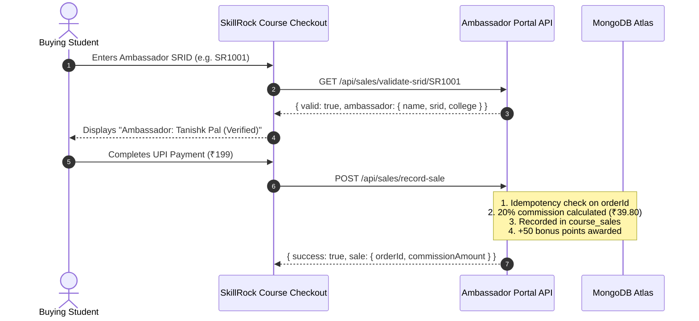

# SkillRock Course Checkout Integration Checklist

This document details how the main SkillRock learning platform (`https://skillrock.onrender.com`) connects with the **SkillRock Student Ambassador Portal** for course referral attribution.

---

## 1. Overview of Referral Flow



---

## 2. API Endpoints Provided by Ambassador Portal

### A. Validate SRID (Server-to-Server or Client AJAX)
- **URL**: `GET /api/sales/validate-srid/:srid`
- **Purpose**: Real-time validation before payment.
- **Request**:
  ```http
  GET /api/sales/validate-srid/SR1001 HTTP/1.1
  Host: portal-api.skillrock.in
  ```
- **Response (Valid)**:
  ```json
  {
    "success": true,
    "valid": true,
    "ambassador": {
      "srid": "SR1001",
      "name": "Tanishk Pal",
      "college": "Bansal College Of Engineering"
    }
  }
  ```
- **Response (Invalid)**:
  ```json
  {
    "success": false,
    "valid": false,
    "message": "SRID 'SR9999' is not recognized or is inactive."
  }
  ```

---

### B. Record Verified Course Sale (Webhook / Payment Confirmation)
- **URL**: `POST /api/sales/record-sale`
- **Payload**:
  ```json
  {
    "orderId": "ORD-2026-9812",
    "paymentId": "PAY-UPI-4819",
    "courseId": "python-programming-zero-to-hero-beginner-to-project-builder",
    "courseName": "Applied Python Programming & Software Development",
    "coursePrice": 199.0,
    "srid": "SR1001",
    "paymentStatus": "paid",
    "buyerName": "Aarav Sharma",
    "buyerEmail": "aarav.student@test.edu"
  }
  ```
- **Response**:
  ```json
  {
    "success": true,
    "message": "Sale successfully attributed to ambassador.",
    "sale": {
      "_id": "6aee...",
      "orderId": "ORD-2026-9812",
      "coursePrice": 199.0,
      "commissionRate": 20,
      "commissionAmount": 39.8,
      "commissionStatus": "approved"
    }
  }
  ```

---

## 3. Changes in SkillRock Main App (`routes/payment.py`)

In `routes/payment.py` inside `verify_utr()` or `process_incoming_bank_credit()`:

```python
import requests

def attribute_ambassador_sale(order_id, payment_id, course_name, course_price, srid, buyer_email=""):
    if not srid or not srid.strip():
        return None
    try:
        ambassador_api_url = os.getenv("AMBASSADOR_PORTAL_API_URL", "http://localhost:5001")
        payload = {
            "orderId": order_id,
            "paymentId": payment_id,
            "courseName": course_name,
            "coursePrice": float(course_price),
            "srid": srid.strip().upper(),
            "paymentStatus": "paid",
            "buyerEmail": buyer_email
        }
        res = requests.post(f"{ambassador_api_url}/api/sales/record-sale", json=payload, timeout=5)
        return res.json()
    except Exception as e:
        logger.error(f"[REFERRAL ATTRIBUTION FAILED]: {e}")
        return None
```

---

## 4. Anti-Fraud & Attribution Guarantees

1. **Server-Side Validation**: Never trusts client-side price or SRID strings.
2. **Anti-Replay Protection**: Orders and payment IDs have unique compound database indexes preventing duplicate sales or commission double-counting.
3. **Refund Cancellation Support**: If an order is refunded, `PUT /api/admin/sales/:saleId/commission` with `commissionStatus: 'void'` marks the commission void and logs an audit record.
